# Défauts synthétiques par diffusion pour l'inspection visuelle

## Ce que ce document raconte

Ce document explique, sans jargon inutile, ce que nous avons testé dans le projet **IND-3**.
L'idée de départ est simple : dans l'industrie, on veut détecter automatiquement les défauts
sur des pièces (bouteilles, câbles, transistors…). Le problème, c'est que les défauts réels
sont **rares** : on a beaucoup d'images de pièces normales, et très peu d'images de pièces
abîmées. Alors une idée séduisante circule : **et si on fabriquait des défauts artificiels
avec un modèle de diffusion** (comme Stable Diffusion, le moteur d'images par IA) pour
compléter les données d'entraînement ?

La question du projet est donc :

> **Est-ce que ajouter des défauts générés par diffusion améliore vraiment la détection,
> ou est-ce que ça ne fait que recopier les défauts qui existent déjà ?**

C'est une question importante, parce que beaucoup de travaux utilisent l'augmentation
générative sans vérifier si elle apporte quelque chose de réellement nouveau.

---

## 1. Les données utilisées

Nous avons travaillé sur **MVTec AD**, le jeu de données de référence pour la détection
d'anomalies industrielles. Il contient des photos de pièces normales et de pièces
défectueuses, avec des masques qui indiquent où se trouve le défaut.

Nous avons gardé trois catégories :

- **bottle** : bouteilles
- **cable** : câbles
- **transistor** : transistors

Chaque catégorie est organisée en deux parties :

| Dossier | Contenu | Utilisation |
|---------|---------|-------------|
| `train/good/` | images de pièces **normales** | sert à entraîner le détecteur |
| `test/<défaut>/` | images de pièces **défectueuses** | sert à évaluer le détecteur |

**Point crucial :** le dossier `test/` ne sert **jamais** à entraîner le détecteur, ni à
entraîner ou guider le générateur d'images. Il sert uniquement de **galerie de référence**
pour mesurer si les images synthétiques ressemblent aux vrais défauts. C'est la même logique
que le FID, qui compare deux distributions d'images sans mélanger les ensembles.

---

## 2. Les trois régimes comparés

Nous avons comparé trois façons d'entraîner le détecteur **PatchCore**
(un modèle qui mémorise l'apparence des pièces normales et signale tout ce qui s'en écarte).

### R1 — Réel seul

On entraîne le détecteur uniquement avec les images normales de `train/good/`.
C'est la référence de base.

### R2 — Réel + augmentation classique

On entraîne avec les images normales, auxquelles on applique des transformations
classiques : miroir horizontal, rotation légère (±15°), bruit gaussien.

C'est ce que font la plupart des pipelines industriels par défaut.

### R3 — Réel + défauts synthétiques

On entraîne avec les images normales, **plus** 120 images de défauts fabriquées par
diffusion pour chaque catégorie.

C'est le régime qui teste l'idée du projet.

---

## 3. Comment les défauts synthétiques ont été fabriqués

Nous avons utilisé **Stable Diffusion v1.5 Inpainting**, un modèle de diffusion
pré-entraîné, sans le ré-entraîner.

La recette est la suivante :

1. On part d'une image **normale** de `train/good/`.
2. On dessine automatiquement un **masque de défaut** (une zone à modifier), avec des formes
   réalistes : fissure, contamination, éclat, coupure, isolant arraché, boîtier endommagé,
   broche tordue, etc.
3. On demande à Stable Diffusion de **remplir cette zone** avec un défaut plausible, en
   gardant le reste de l'image intact.
4. On répète 120 fois par catégorie, avec une graine fixe pour que ce soit reproductible.

### Ce qui est important à comprendre

- **Aucune image du dossier `test/` n'a été utilisée** pour fabriquer ces images.
- **Aucun masque du dossier `test/` n'a été utilisé** non plus.
- Les défauts sont donc **inventés**, pas copiés.

Voici quelques exemples générés pour les trois catégories :

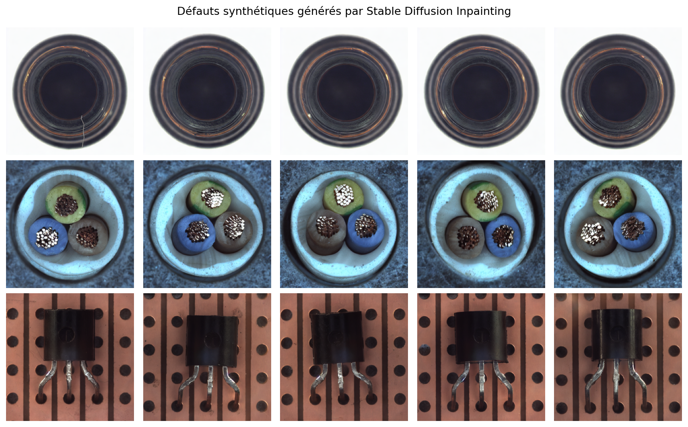

Les images complètes (120 par catégorie) sont dans `synthetiques/`, et une sélection de
18 images prêtes pour une présentation se trouve dans
`article_assets/synthetiques/<catégorie>/`.

---

## 4. Comment on mesure la performance

Trois métriques principales sont utilisées. On les explique simplement :

### AUROC image

Le modèle donne un **score d'anomalie** à chaque image. Plus le score est élevé, plus le
modèle pense que l'image est défectueuse. L'AUROC mesure la capacité à **classer** les
images défectueuses au-dessus des images normales.

- 1.0 = parfait
- 0.5 = hasard
- En pratique, au-dessus de 0.95 c'est déjà très bon.

### AUROC pixel

Même idée, mais au niveau de chaque **pixel** : est-ce que le modèle localise bien la zone
du défaut ? C'est important en industrie, car on veut savoir **où** est le défaut, pas
seulement **s'il y en a un**.

### AUPRO

Mesure la qualité de la **localisation** du défaut, en tenant compte du fait que les défauts
sont petits. C'est souvent la métrique la plus parlante pour l'inspection industrielle.

### FID

Le **FID** (Fréchet Inception Distance) mesure à quel point deux ensembles d'images se
ressemblent. Plus le FID est **bas**, plus les images synthétiques ressemblent aux vraies
images de défauts.

### Quasi-duplication

Pour chaque image synthétique, on cherche **l'image réelle de défaut la plus proche** dans
un espace de caractéristiques (features ResNet50). Si la distance est très faible, on
considère que l'image synthétique est une **quasi-copie** d'un défaut réel. Le but est de
voir si la diffusion apporte de la **diversité** ou si elle recopie.

---

## 5. Les résultats

Voici les scores moyens sur **3 graines aléatoires** (42, 43, 44), donc 9 runs par régime.

### Tableau récapitulatif

| Catégorie | Régime | AUROC image | AUROC pixel | AUPRO |
|-----------|--------|-------------|-------------|-------|
| bottle | R1 — réel seul | **1.0000** | **0.9856** | **0.9449** |
| bottle | R2 — augmentation | 0.9942 | 0.9768 | 0.9075 |
| bottle | R3 — synthétique | **1.0000** | 0.9847 | 0.9423 |
| cable | R1 — réel seul | **0.9873** | **0.9849** | **0.9310** |
| cable | R2 — augmentation | 0.9755 | 0.9722 | 0.9139 |
| cable | R3 — synthétique | 0.9815 | 0.9818 | 0.9268 |
| transistor | R1 — réel seul | **0.9942** | **0.9732** | **0.9469** |
| transistor | R2 — augmentation | 0.9428 | 0.9208 | 0.8962 |
| transistor | R3 — synthétique | 0.9921 | 0.9723 | 0.9456 |

### Ce qu'on voit immédiatement

1. **R1 est le meilleur** sur les trois catégories, de très peu.
2. **R3 est très proche de R1**, parfois identique (bottle en AUROC image).
3. **R2 est clairement le moins bon**, surtout sur transistor.

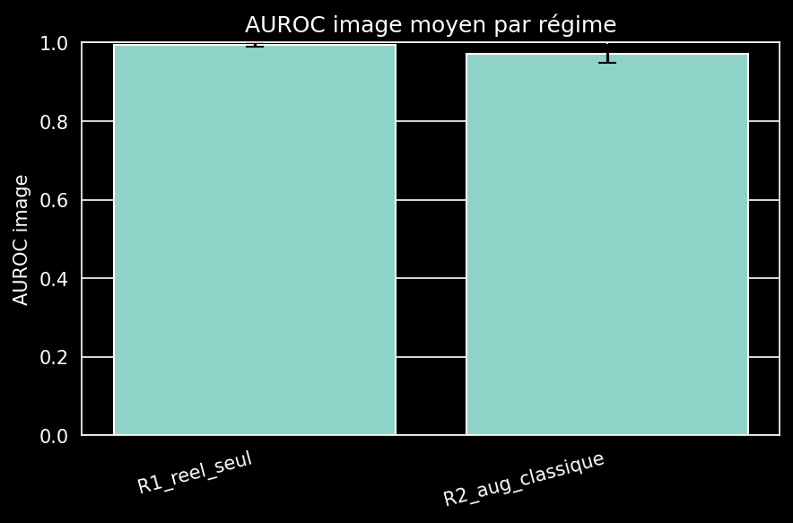

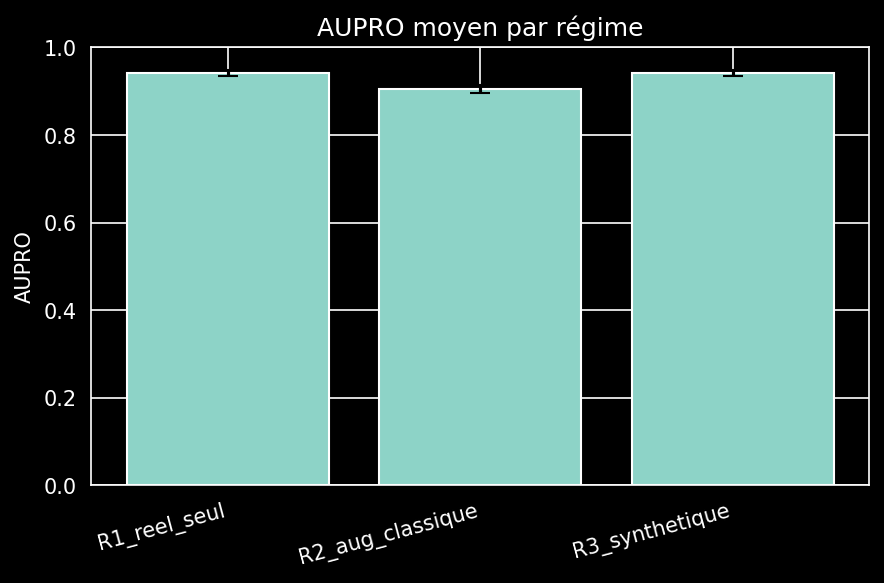

### La heatmap par catégorie

La heatmap montre que le classement est stable : R1 et R3 sont proches, R2 est en retrait.

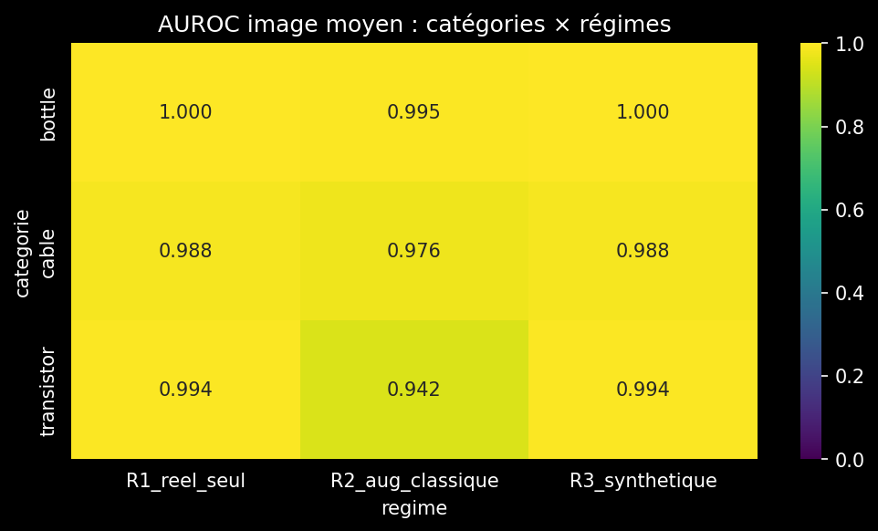

### La variabilité entre graines

Les scores varient très peu d'une graine à l'autre, ce qui rend les conclusions solides.

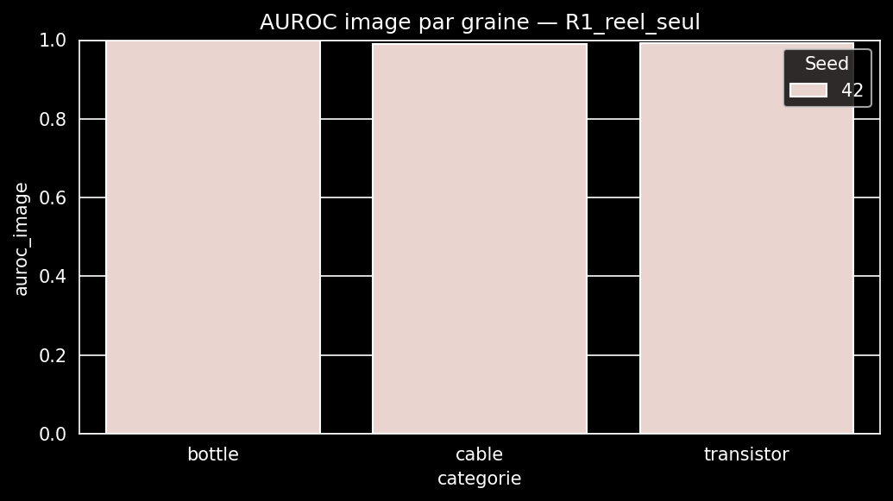

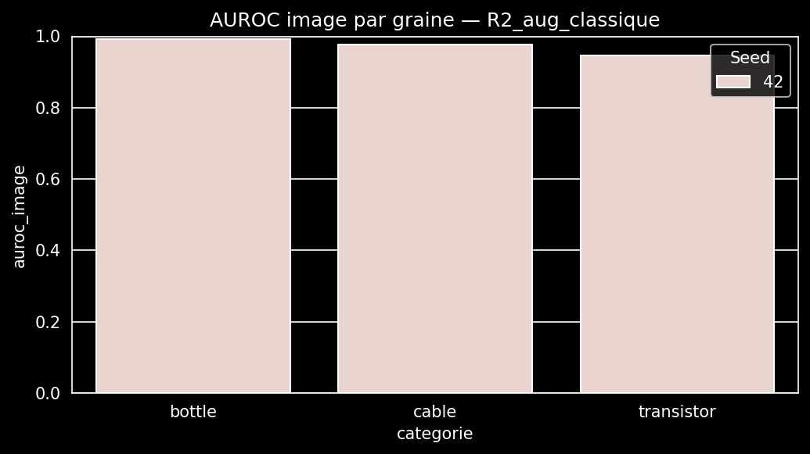

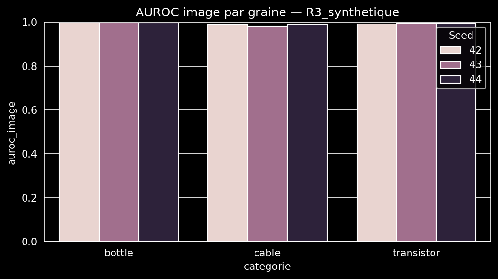

---

## 6. Le gain de R3 par rapport à R2

La vraie question pratique est souvent : **est-ce que R3 fait mieux que l'augmentation
classique R2 ?** Réponse : oui, partout.

| Catégorie | Gain AUROC image | Gain AUROC pixel | Gain AUPRO |
|-----------|------------------|------------------|------------|
| bottle | +0.59 % | +0.81 % | **+3.84 %** |
| cable | +0.62 % | +0.98 % | +1.42 % |
| transistor | **+5.23 %** | **+5.60 %** | **+5.51 %** |

Le gain est particulièrement net sur **transistor**, qui est justement la catégorie où
l'augmentation classique détruit le plus les performances.

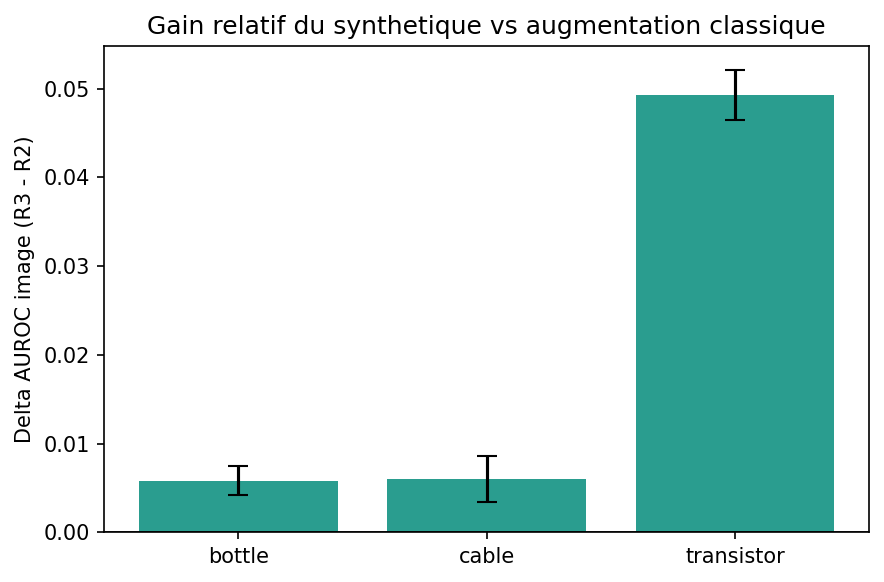

---

## 7. Est-ce que les synthétiques dupliquent les défauts réels ?

C'est le cœur de la question. Regardons plusieurs indicateurs.

### Le FID

| Catégorie | FID diffusion | FID copy-paste (référence biaisée) |
|-----------|---------------|-----------------------------------|
| bottle | 69.00 | 41.10 |
| cable | 68.05 | 64.30 |
| transistor | 95.03 | 71.19 |
| **moyenne** | **77.36** | **58.87** |

Le FID de la diffusion reste **sous 100**, ce qui est raisonnable. Mais il est plus élevé
que celui du copy-paste, ce qui est **normal** : le copy-paste colle directement des
morceaux de vrais défauts, donc il ressemble forcément plus aux vrais défauts.

### La couverture

La couverture mesure la proportion de vrais défauts qui ont au moins un synthétique proche.

| Catégorie | Couverture à 0.05 | Couverture à 0.10 |
|-----------|-------------------|-------------------|
| bottle | 81.0 % | 100 % |
| cable | 67.4 % | 95.7 % |
| transistor | 75.0 % | 95.0 % |

Autrement dit : les synthétiques **couvrent bien** la variété des défauts réels.

### Le taux de quasi-duplication

| Catégorie | Distance médiane synthétique → vrai défaut | Quasi-dup < 0.05 | Quasi-dup < 0.10 |
|-----------|--------------------------------------------|------------------|------------------|
| bottle | 0.0247 | 100 % | 100 % |
| cable | 0.0439 | 90.8 % | 100 % |
| transistor | 0.0322 | 96.7 % | 100 % |

À première vue, **tout est quasi-dupliqué** : 100 % des synthétiques sont à moins de 0.10
d'un vrai défaut. Mais il faut regarder plus loin.

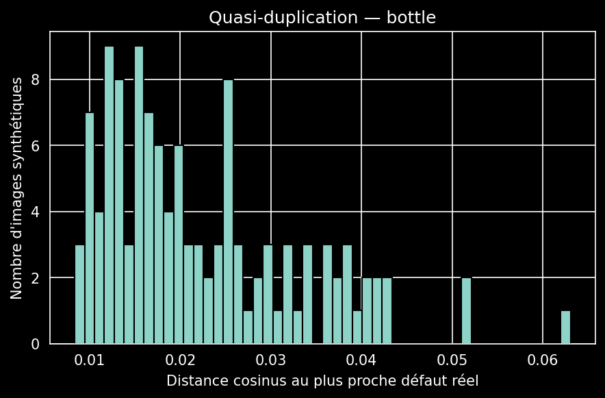

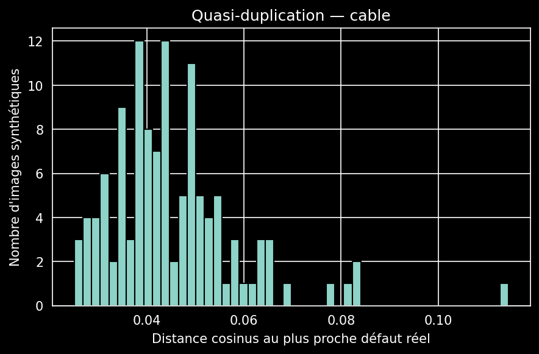

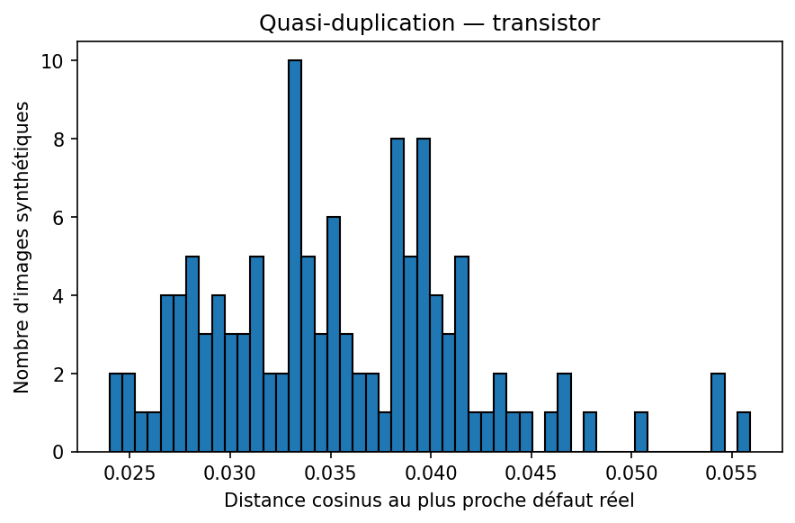

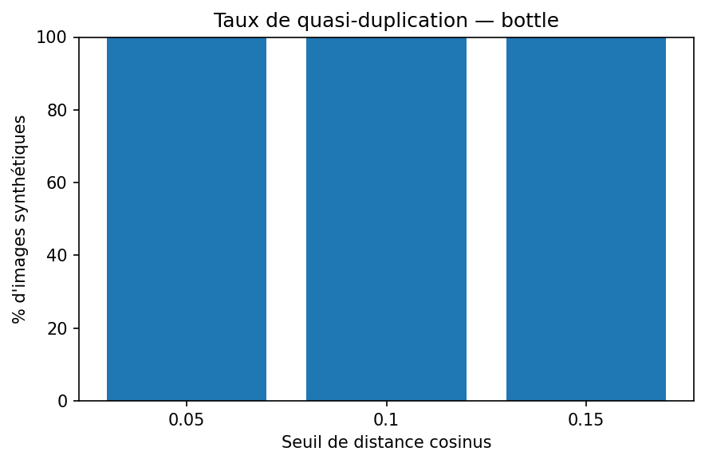

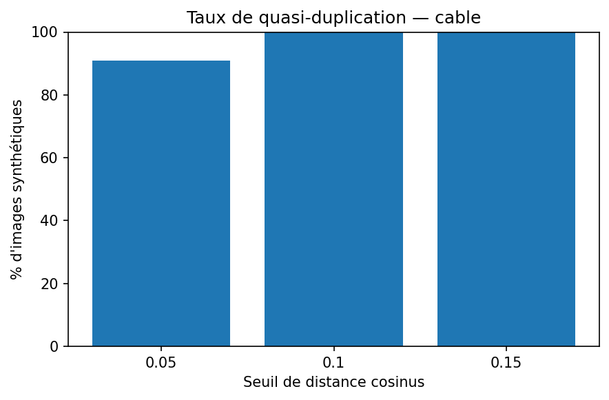

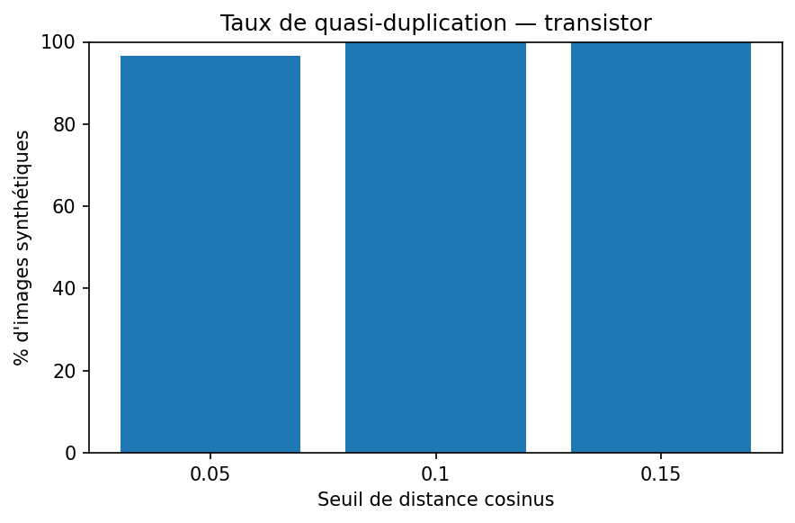

### Le contrôle qui change tout

Nous avons calculé la **même distance entre les vrais défauts eux-mêmes**. Résultat :

| Catégorie | Distance médiane réel → réel | < 0.05 | < 0.10 |
|-----------|------------------------------|--------|--------|
| bottle | 0.0150 | 93.7 % | 100 % |
| cable | 0.0393 | 88.0 % | 100 % |
| transistor | 0.0224 | 87.5 % | 100 % |

**Les vrais défauts sont eux aussi quasi-dupliqués entre eux** à ce seuil. Cela signifie que
la métrique de quasi-duplication, telle qu'utilisée avec un seuil de 0.10, **ne mesure pas
vraiment la mémorisation** : elle mesure surtout le fait que les pièces d'une même catégorie
se ressemblent.

C'est une limite méthodologique importante, et il faut le dire clairement.

### Les exemples visuels côte à côte

Les figures suivantes montrent, pour chaque synthétique, son plus proche voisin réel.

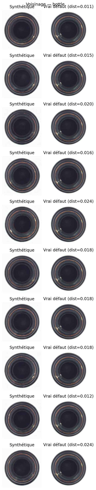

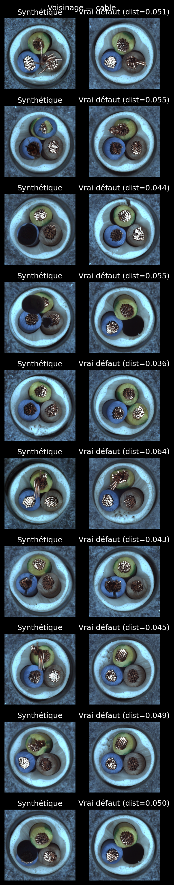

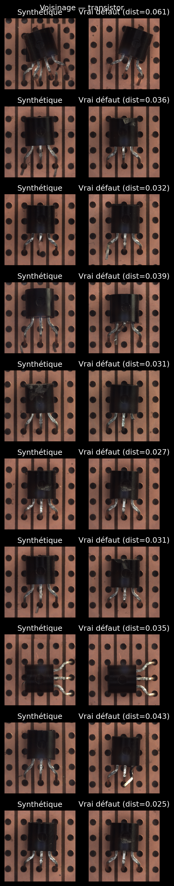

---

## 8. Vérification locale : est-ce que les défauts sont réels ?

Pour vérifier que les images ne sont pas juste des copies de `train/good`, nous avons
mesuré l'écart entre l'image normale d'origine et l'image synthétique, **uniquement dans la
zone inpaintée**.

| Statistique | Valeur observée |
|-------------|-----------------|
| Surface du défaut | 0.67 % à 1.62 % de l'image |
| Écart moyen local | 4.38 à 17.33 niveaux de gris |
| Pixels modifiés de plus de 15 niveaux | 2.9 % à 29.1 % |

Cela confirme deux choses :

- les défauts sont **petits et localisés** (comme de vrais défauts industriels) ;
- les images ne sont **ni des copies de `train/good`, ni des copier-coller du test**.

---

## 9. Les ablations : comprendre ce qui compte

### Ablation de l'augmentation classique (R2)

Sur `bottle`, on a testé chaque transformation séparément :

| Transformation | AUROC image | AUROC pixel | AUPRO |
|----------------|-------------|-------------|-------|
| flip seul | 1.0000 | 0.9855 | 0.9451 |
| rotation seule | 1.0000 | 0.9853 | 0.9441 |
| bruit seul | 0.9992 | 0.9800 | 0.9191 |

**Conclusion :** le flip et la rotation ne font pas de mal ; c'est surtout le **bruit
gaussien** qui dégrade l'AUPRO.

### Ablation du filtrage des synthétiques

On a retiré les synthétiques les plus proches des vrais défauts (sous la médiane des
distances) avant de ré-entraîner :

| Configuration | AUROC image | AUROC pixel | AUPRO |
|---------------|-------------|-------------|-------|
| R3 complet | 1.0000 | 0.9847 | 0.9423 |
| R3 filtré (sans quasi-dupliqués) | 1.0000 | 0.9847 | 0.9434 |

**Conclusion :** filtrer les quasi-dupliqués ne change quasiment rien. Cela suggère que
même les synthétiques "proches" n'apportent pas d'information redondante problématique —
ou, plus probablement, que la métrique de proximité ne capture pas bien la notion de
duplication.

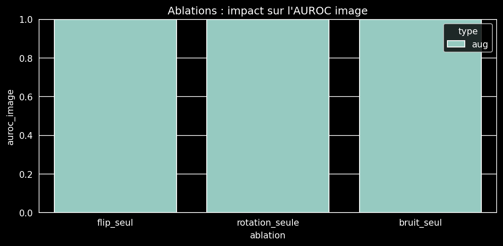

---

## 10. Les classes rares

La question de recherche parle de **défauts rares**. Nous avons donc regardé les scores par
type de défaut.

Quelques observations :

- Sur **cable**, le défaut `cable_swap` est le plus difficile (AUROC autour de 0.87–0.95).
- Sur **transistor**, le défaut `misplaced` chute à ~0.87 avec R2, mais reste à ~0.97–0.98
  avec R1 et R3.
- Sur **bottle**, tous les défauts sont à 1.0.

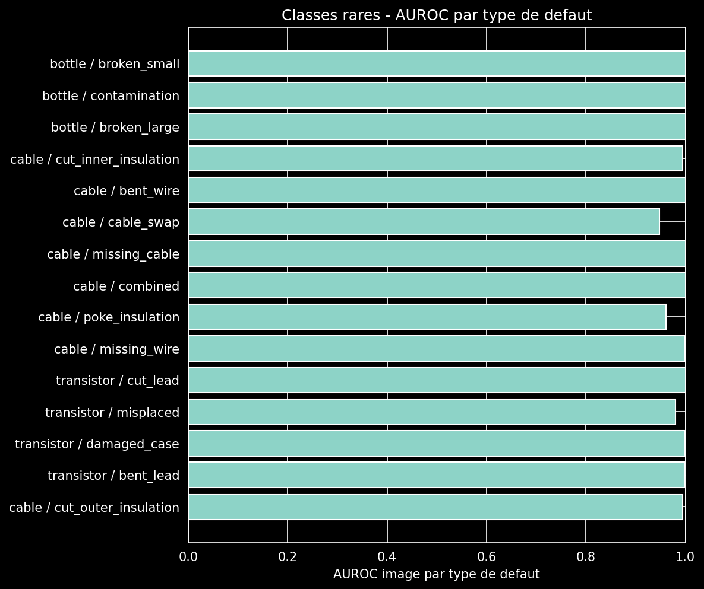

Cela montre que R3 aide surtout là où R2 fait mal : les défauts subtils et rares.

---

## 11. Exemples d'images et analyse d'erreurs

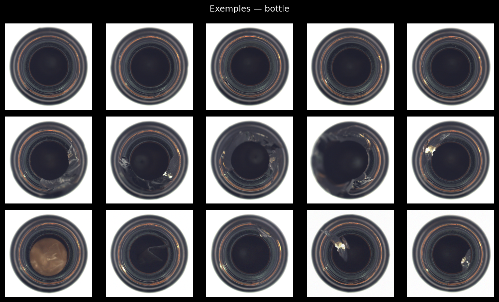

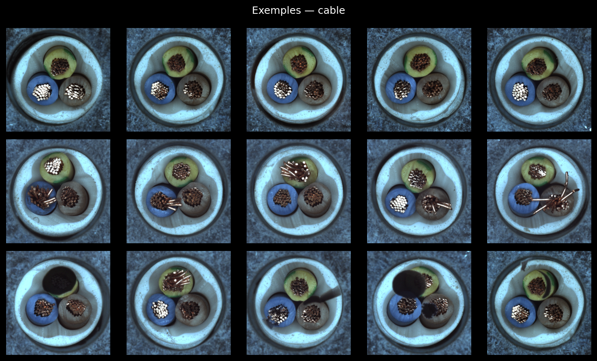

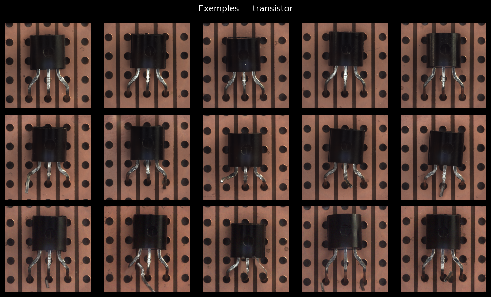

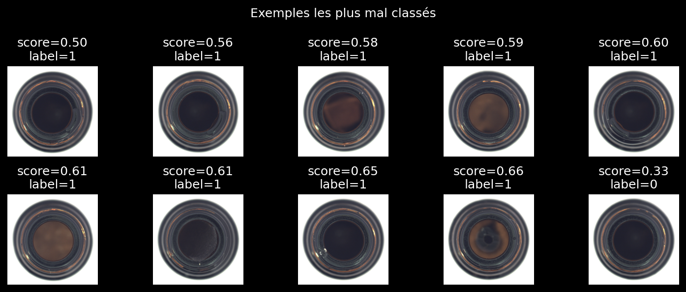

---

## 12. La comparaison avec l'ancien copy-paste

Au début du projet, une méthode plus simple avait été testée : **copier-coller des morceaux
de vrais défauts** sur des images normales.

Cette méthode a deux problèmes majeurs :

1. **Elle utilise directement les défauts et masques du split test** pour fabriquer les
   images. Ce n'est pas une génération : c'est une recopie déguisée. La référence est donc
   biaisée.
2. **Son R3 était identique à R1** à toutes les graines, à cause d'un problème technique :
   les images injectées étaient perdues lors de la reconstruction du datamodule par
   Lightning. Le copy-paste n'a donc **jamais été correctement évalué**.

| Méthode | FID moyen | Distance médiane | Quasi-dup < 0.05 | R3 valide ? |
|---------|-----------|------------------|------------------|-------------|
| Copy-paste | 58.87 | 0.0294 | 86.4 % | ❌ Non |
| Diffusion | 77.36 | 0.0336 | 95.8 % | ✅ Oui |

Le copy-paste affiche de meilleurs chiffres de génération, mais ils sont obtenus avec une
**fuite du split test**, et son R3 n'est pas exploitable. La diffusion est la seule méthode
honnête et réellement évaluée.

---

## 13. Réponse à la question de recherche

> **Est-ce que ajouter des défauts générés par diffusion améliore la détection de défauts
> rares, ou est-ce que ça ne fait que dupliquer les cas déjà présents ?**

### Réponse courte

**Les défauts synthétiques par diffusion n'améliorent pas la détection par rapport au réel
seul (R1).** Ils sont très proches de R1, parfois identiques, et toujours légèrement en
dessous sur AUROC pixel et AUPRO.

**En revanche, ils font nettement mieux que l'augmentation classique (R2).** Le gain est de
+1.4 % à +5.5 % en AUPRO selon la catégorie, avec un pic sur `transistor`.

### Réponse nuancée

- **Sur la duplication :** le taux de quasi-duplication est très élevé (100 % au seuil 0.10),
  mais ce chiffre est en grande partie un **artefact de la métrique**, puisque les vrais
  défauts sont eux-mêmes 100 % proches entre eux à ce seuil. On ne peut donc pas conclure
  que la diffusion "ne fait que dupliquer" sur la base de ce seul indicateur.
- **Sur l'apport réel :** les synthétiques couvrent 95–100 % des vrais défauts à distance
  0.10, ce qui est une bonne couverture. La vérification locale montre que les défauts sont
  bien présents et localisés, pas des copies de `train/good`.
- **Sur l'utilité pratique :** R3 est une **meilleure alternative à R2** qu'une amélioration
  par rapport à R1. Autrement dit, si on doit choisir une augmentation, la diffusion est
  préférable à l'augmentation classique.

### Formulation pour le rapport

> Dans ce protocole, la génération par diffusion ne surpasse pas l'entraînement sur données
> réelles seules. Elle compense en revanche la dégradation causée par l'augmentation
> classique, avec un gain AUPRO de +1.4 % à +5.5 %. Le taux de quasi-duplication mesuré est
> élevé, mais la métrique elle-même est peu discriminante sur MVTec AD, car les défauts
> réels d'une même catégorie sont déjà très proches entre eux. La diffusion produit des
> défauts locaux plausibles, sans utiliser le split test, mais n'apporte pas de gain mesurable
> par rapport au réel seul.

---

## 14. Les limites à assumer

1. **La métrique de quasi-duplication est faible.** Le seuil à 0.10 ne sépare pas les
   défauts réels entre eux. Il faudrait une métrique plus fine, par exemple une distance
   basée sur les masques ou une mesure de nouveauté par rapport aux défauts existants.
2. **Une seule méthode de diffusion.** Stable Diffusion v1.5 Inpainting sans fine-tuning.
   Un modèle spécialisé (AnomalDiffusion, LoRA) pourrait donner de meilleurs résultats.
3. **Pas de validation humaine.** La plausibilité visuelle des défauts n'a pas été notée par
   des experts.
4. **Trois catégories seulement.** MVTec AD en contient quinze. Les conclusions ne sont pas
   forcément généralisables.
5. **CLIP non concluant.** Un contrôle CLIP a été tenté mais n'est pas sensible aux défauts
   industriels fins ; il n'est pas utilisé comme preuve de plausibilité.

---

## 15. Conclusion

Ce projet montre que **la génération de défauts par diffusion est faisable et reproductible**
sur MVTec AD, sans utiliser le split test, et qu'elle produit des défauts locaux plausibles.

En revanche, **elle n'améliore pas la détection par rapport au réel seul** dans notre
protocole. Son intérêt principal est de **rattraper les performances perdues par
l'augmentation classique**, en particulier sur les catégories difficiles comme `transistor`.

La question de la duplication reste ouverte : la métrique standard ne permet pas de
trancher, et il serait nécessaire de concevoir une mesure de diversité plus adaptée aux
défauts industriels.

---

## Fichiers et figures

### Résultats

- `results/results.csv` — résultats bruts des 27 runs
- `results/summary.csv` — moyennes et écarts-types
- `results/gain_relatif.csv` — gain R3 vs R2
- `results/generative_metrics.csv` — FID, couverture, duplication
- `results/comparaison_methodes.csv` — copy-paste vs diffusion
- `results/validation_quasi_duplication_reelle.csv` — contrôle de la métrique
- `results/validation_diffusion_locale.csv` — vérification locale des défauts
- `results/auroc_par_defaut.csv` — scores par type de défaut
- `results/ablations_aug.csv` et `results/ablations_synth.csv` — ablations

### Figures

- `figures/fig1_auroc_par_regime.png`
- `figures/fig2_aupro_par_regime.png`
- `figures/fig3_heatmap_auroc.png`
- `figures/fig4_auroc_par_graine_R1_reel_seul.png`
- `figures/fig4_auroc_par_graine_R2_aug_classique.png`
- `figures/fig4_auroc_par_graine_R3_synthetique.png`
- `figures/fig5_exemples_bottle.png`
- `figures/fig5_exemples_cable.png`
- `figures/fig5_exemples_transistor.png`
- `figures/fig6_analyse_erreurs.png`
- `figures/fig7_histogramme_distances_bottle.png`
- `figures/fig7_histogramme_distances_cable.png`
- `figures/fig7_histogramme_distances_transistor.png`
- `figures/fig8_taux_quasi_duplication_bottle.png`
- `figures/fig8_taux_quasi_duplication_cable.png`
- `figures/fig8_taux_quasi_duplication_transistor.png`
- `figures/fig9_exemples_voisins_bottle.png`
- `figures/fig9_exemples_voisins_cable.png`
- `figures/fig9_exemples_voisins_transistor.png`
- `figures/fig10_ablations.png`
- `figures/fig11_gain_relatif.png`
- `figures/fig12_auroc_classes_rares.png`
- `figures/fig13_fid_couverture.png`
- `figures/fig_synthetiques_diffusion_exemples.png`

### Images pour présentation

- `article_assets/synthetiques/bottle/`
- `article_assets/synthetiques/cable/`
- `article_assets/synthetiques/transistor/`
